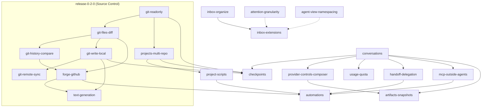

# Program: 機能台帳・依存グラフ・後続リリース計画

Issue #22 (Program: T3 Code 機能の最大化と herdr エコシステムへの統合) の
受入条件を満たす repository-local 正本。機械可読な正本は
[`feature-ledger.json`](feature-ledger.json)、本ファイルは人間向け索引。

## 正本の構成

| ファイル | 役割 |
| --- | --- |
| `docs/program/feature-ledger.json` | 機械可読台帳 (schema_version 1.0.0) |
| `docs/program/README.md` | 本ファイル。索引・依存グラフ・リリース計画 |
| `docs/research/t3code-feature-inventory.md` | 初期調査の履歴 (正本は本ディレクトリ) |

### 台帳スキーマ (`schema_version: "1.0.0"`)

- `pinned_revisions`: 上流照合基準。T3 Code は `9cc4018c`、本リポジトリは
  台帳作成時点の `release-0-2-0` HEAD を記録する。
- `classification_legend`: 分類の定義 (JSON 内にも同内容を保持)。
- `features[]`: 機能エリアごとのエントリ。
  - `id`: 台帳内一意 ID (依存グラフのノード名)。
  - `title_ja`: 日本語タイトル。
  - `upstream_refs`: T3 Code `9cc4018c` の `docs/`・`apps/`・`packages/`
    パス。Issue 記載の参照が pinned revision に存在しない場合は実在パスへ
    修正し `verification` に差異を記録する。
  - `classification`: `existing` / `plugin` / `gui-integration` /
    `partial` / `unimplemented` / `upstream-blocked` / `out-of-scope` /
    `not-feasible`。
  - `issues`: 対応 GitHub Issue 番号 (親 Issue を含む)。
  - `depends_on`: 依存。`"#NN"` は Issue 依存、裸の文字列は台帳 `id` 依存。
  - `acceptance`: 受入条件の要約 (日本語)。
  - `verification`: 検証証拠の状態・メモ。
  - `reason` / `resolution`: `upstream-blocked`・`not-feasible`・
    `out-of-scope` では理由と解決条件を必須記録。

### 分類凡例

| classification | 意味 |
| --- | --- |
| `existing` | 実装済み (plugin または herdr コア/既存運用基盤) |
| `plugin` | herdr plugin として実装対象。Issue・train 割当あり |
| `gui-integration` | herdr-t3 等クライアント側の責務 (plugin 契約の消費) |
| `partial` | 一部対応済み、または既存基盤で大部分を充足し残差のみ要対応 |
| `unimplemented` | 未着手。Issue はあるが計画具体化これから |
| `upstream-blocked` | herdr/T3Code 上流 API 不足がブロッカー |
| `out-of-scope` | 本エコシステムの責務外 |
| `not-feasible` | 技術的・ポリシー上実現不能 (理由・解決条件を記録) |

## 依存グラフ

Issue 番号ベースの直列・blocked-by 関係 (release-0-2-0):

- #35 → #36 (同一ファイル群のため直列化、hard dependency ではない)
- #35 → #37 → #38 (操作面の直列)
- #35, #36 → #39 (Forge 基盤)

## リリース train 対応 (暫定)

> **暫定注意**: v0.2.0 以降の train 順序・バージョン番号は暫定であり、
> 依存関係・公開価値・検証費用で確定する。#22 の方針に従い、実装・
> 統合・実機・GUI 利用可否は別々に追跡する。

| Train | Issue | 機能エリア (台帳 id) | 状態 |
| --- | --- | --- | --- |
| release-0-1-0 | (済) | `inbox-organize` (#7 契約), `git-readonly` (#20/#21) | リリース済み |
| release-0-2-0 | #2, #23, #24, #25, #35-#39 | Source Control 一連: `git-files-diff`, `git-history-compare`, `git-write-local`, `git-remote-sync`, `forge-github` | 実装完了・リリース承認待ち (#25 残差は後続 train) |
| release-0-3-0 | #26, #3, #48-#53, #65-#69 | `projects-multi-repo`, `project-scripts` | RC 検証済み・リリース承認待ち (#69: 監査3項目収束 + `docs/research/rc-0-3-0-verification.md`。残差: #60 自動トリガー、#70 clone/init/publish+worktree 関連付け) |
| 次期 train (暫定) | #4 | `checkpoints` (#23/#24/#26/#5 と接続) | 未着手 |
| 次期 train (暫定) | #5, #28 | `conversations`, `usage-quota` | 未着手 |
| 次期 train (暫定) | #27, #6, #29 | `provider-controls-composer`, `handoff-delegation`, `text-generation` | 未着手 |
| 次期 train (暫定) | #33 | `inbox-extensions` (#8/#9 upstream gap 依存) | 未着手 |
| 次期 train (暫定) | #30, #31, #32 | `mcp-outside-agents`, `artifacts-snapshots`, `automations` | 未着手 |
| 次期 train (暫定) | #34 | `secrets-remote-devices` (棚卸し・責務割当) | 未着手 |
| 上流待ち | #8, #9 | `attention-granularity`, `agent-view-namespacing` | upstream Issue 候補 |
| 責務外 | — | `client-polish-misc`, `execution-runtime` | out-of-scope |
| 後続検討 | #25 残差 | `forge-non-github` | GitHub 基盤 (#39) 後に Forge 別分解 |

## upstream-blocked / 対応不能の記録

| 台帳 id | 分類 | 理由 | 解決条件 |
| --- | --- | --- | --- |
| `attention-granularity` (#8) | upstream-blocked | herdr `agent_status` が approval/user-input/failure を `blocked` に集約。PTY 推測は禁止 | herdr upstream へ構造化 attention イベント/拡張 status を要望。再現条件・提案 API・影響を添えて upstream candidate 化 |
| `agent-view-namespacing` (#9) | upstream-blocked | `agent.view.set` が全 plugin 共通の単一スロット | plugin source 別 view スロット/namespaced registry + ライフサイクル連動クリアを upstream 要望。代替は herdr-t3 UI (#7) |

現時点で `not-feasible` の機能エリアはなし。`out-of-scope` は
`execution-runtime` (herdr core 所有) と `client-polish-misc`
(クライアント polish・上流サービス) で、いずれも理由と解決条件を
台帳に記録済み。

## 運用

- 機能追加・Issue 起票のたびに本台帳を更新する。新機能は `features[]`
  へ追加し、`issues`・`depends_on`・`acceptance`・`verification` を埋める。
- `upstream_refs` は必ず pinned revision `9cc4018c` の実在パスを指す。
  Issue 記載パスが存在しない場合 (例: `docs/user/workflows.md`,
  `docs/user/multi-repo-projects.md`) は実体パスへ修正し差異を
  `verification` に記録する。
- 各 ticket PR の受入条件に「上流照合結果を機能台帳へ記録」があるため、
  実装 PR では対応エントリの `verification` を更新する。
